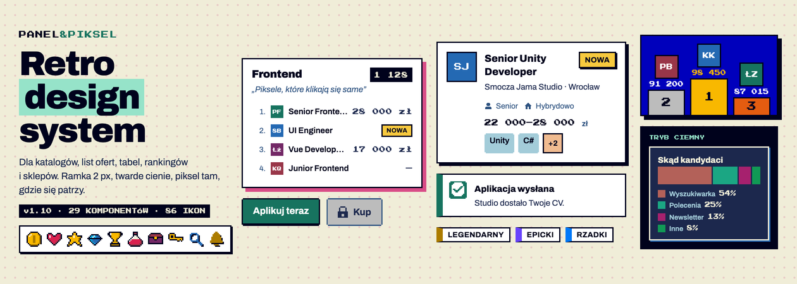

# Panel & Piksel — retro design system



Retro-pikselowy design system dla **katalogów, list ofert, tabel, rankingów i sklepów**. Białe panele z czarną ramką 2 px i twardym cieniem, gęste numerowane listy, czytelny tekst w Archivo, a piksel (Press Start 2P) tam, gdzie się patrzy, a nie czyta: w liczbach, kwotach, rangach i licznikach. Paleta SNES (Jehkoba32) z akcentami NES.

Wersja: **1.11.0** (plik `skills/panel-piksel-ui/VERSION`) · właściciel: Konrad Kosiorek · licencja fontów: OFL (Google Fonts)

## Co jest w środku

| | |
|---|---|
| **Specyfikacja** | [`design.md`](design.md) — jedno źródło prawdy: esencja i 10 zasad, kolor, typografia, przestrzeń, ikony, komponenty (§6), treści (§6A), wzorce ekranów, dostępność, gotowy kod (§9), „czego nie robić”, historia zmian |
| **Kod systemu** | [`skills/panel-piksel-ui/assets/`](skills/panel-piksel-ui/assets) — `tokens.css`, `components.css`, `icons.css` (86 ikon SVG), skrypty `list-controls.js`, `table-sort.js`, `ui-controls.js`, `charts.js`, szablon `starter.html`, tokeny W3C `tokens.json`, rejestr komponentów `components.json` |
| **Przykłady na żywo** | [`skills/panel-piksel-ui/examples/`](skills/panel-piksel-ui/examples) — wszystkie komponenty, warianty i stany (jasny i ciemny), wzorce, galeria ikon |
| **Skill dla agentów** | [`skills/panel-piksel-ui/`](skills/panel-piksel-ui) — skill Claude Code, który buduje ekrany i migruje istniejące strony na Panel & Piksel; testy w `evals/` |
| **Dokumentacja dla designerów** | [`docs/panel-piksel-komponenty-v2.html`](docs/panel-piksel-komponenty-v2.html) — 29 kart rodzin komponentów z anatomią, wariantami, tokenami i dostępnością |
| **Strona dokumentacji** | [`site/`](site) — statyczna strona w stylu IBM Carbon, gotowa do Cloudflare Pages ([CLOUDFLARE.md](CLOUDFLARE.md)) |
| **Badania** | `research/` — studium kierunku, porównanie palet, moodboard; tylko lokalnie u właściciela (zawierają zrzuty cudzych stron), poza repozytorium |

Rejestr: 21 komponentów stabilnych, 21 testowych, 4 wycofywane — tabela w `design.md` §0.1.

## Szybki start — użyj systemu na swojej stronie

```html
<link href="https://fonts.googleapis.com/css2?family=Archivo:ital,wght@0,400;0,600;0,700;0,800;0,900;1,400&family=Press+Start+2P&display=swap" rel="stylesheet">
<link rel="stylesheet" href="panel-piksel/tokens.css">
<link rel="stylesheet" href="panel-piksel/components.css">
<link rel="stylesheet" href="panel-piksel/icons.css">

<section class="panel">
  <div class="panel-head"><h2>Frontend</h2><span class="count">1 128</span></div>
  <ol class="list">
    <li><a href="#"><span class="list-n">1.</span><span class="list-name">Senior Frontend Dev</span><span class="list-value">28 000 zł</span></a></li>
  </ol>
</section>
<button class="btn btn-primary" type="button">Aplikuj teraz</button>
```

Najprościej: pobierz paczkę `panel-piksel-<wersja>.zip` (ze strony dokumentacji → „Pobierz” albo zbuduj ją — niżej), skopiuj `panel-piksel/` do projektu i zacznij od `panel-piksel/starter.html`. Nie edytuj plików systemu — style ekranu dopisuj osobno, tylko przez tokeny `var(--…)`.

**Tryb ciemny:** `<html data-theme="dark">` (albo `auto`).

## Z agentem (Claude Code)

Skopiuj skill do `~/.claude/skills/panel-piksel-ui` (albo do `.claude/skills/` w swoim projekcie) i poproś np.:

> Zbuduj ekran listy ofert z filtrami w stylu Panel & Piksel.

> Przenieś tę stronę na design system Panel & Piksel — zmień wygląd, nie zmieniaj treści ani działania.

Skill składa ekran z klas systemu, a na końcu sprawdza go skryptami `check_screen.py` (zasady) i `render_check.py` (render 1280/390 px, martwe kontrolki).

## Budowanie

Wymagania: Python 3.10+, Google Chrome (testy renderu i wizualne). Wszystko uruchamiasz z katalogu repozytorium:

```bash
python3 tools/build_all.py
```

To odbudowuje kolejno: kopie systemu i `design.md` §0/§9 → dokumentację dla designerów (`docs/`) → paczkę `dist/panel-piksel-<wersja>.zip` → stronę `site/` → `dist/panel-piksel-site-<wersja>.zip`. Katalog `dist/` nie trafia do repozytorium — paczki budujesz lokalnie.

| Paczka | Do czego |
|---|---|
| `dist/panel-piksel-<wersja>.zip` | do dzielenia się systemem: `design.md`, `panel-piksel/` (CSS, JS, ikony, tokeny), przykłady, dokumentacja, skill |
| `dist/panel-piksel-site-<wersja>.zip` | strona dokumentacji do wgrania w Cloudflare Pages (Upload assets) |

Testy:

```bash
python3 tools/build_all.py --check
```

```bash
python3 skills/panel-piksel-ui/scripts/check_screen.py skills/panel-piksel-ui/examples/komponenty.html
```

```bash
python3 skills/panel-piksel-ui/scripts/visual_regression.py tests/visual skills/panel-piksel-ui/examples/*.html
```

## Publikacja strony

Cloudflare Pages: wgraj `dist/panel-piksel-site-<wersja>.zip` albo połącz to repozytorium (Build command: puste, Build output directory: `site`). Szczegóły: [CLOUDFLARE.md](CLOUDFLARE.md).

## Zmiany w systemie

Nowe komponenty i zmiany przechodzą przez proces z `design.md` §0: kandydat → testowy → stabilny → wycofywany, z checklistą „gotowe” i wersjonowaniem semver (poprawka · nowy element lub wycofanie · usunięcie). Historia: `design.md` §12.

Instrukcje dla agentów pracujących z tym repozytorium: [CLAUDE.md](CLAUDE.md).
